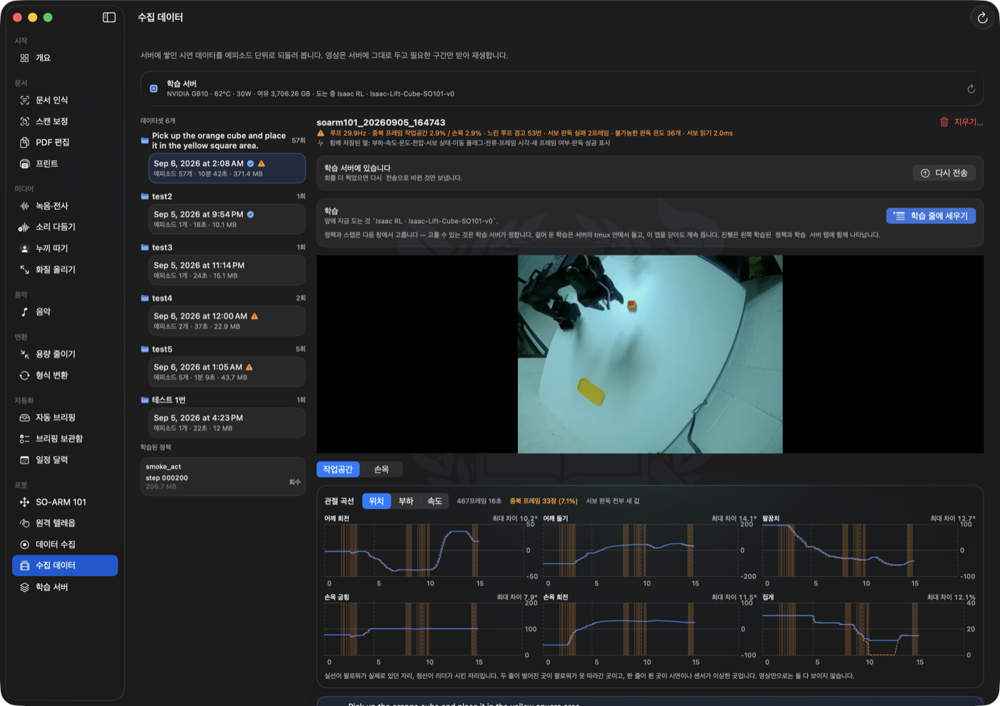
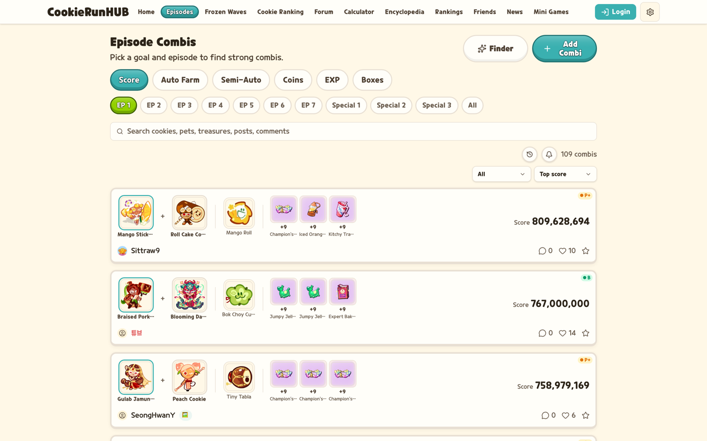

# 박세환 · Sehwan Park

서울대학교 자유전공학부 25학번 · 전기정보공학부 전공 · [SHAPE](https://github.com/snu-shape)

로봇을 원격으로 조작하고, 사람의 시연을 모아 로봇이 배울 수 있게 만드는 일에 관심이 있습니다.
SHAPE에서 휴머노이드 텔레오퍼레이션을 맡았고, 개인적으로는 로봇팔 제어부터 데이터 수집·학습까지 이어지는 도구를 만들고 있습니다.

[로봇 활동](#로봇-활동) · [기타 활동](#기타-활동) · [이메일](mailto:park7132872@snu.ac.kr)

## 로봇 활동

### SHAPE · 휴머노이드 챌린지

ROBOTIS AI Worker를 사용하는 팀 프로젝트에서 **원격 조작 화면과 카메라·주행 제어**를 담당했습니다.
영상 패널을 RViz에서 분리하고, 손목 카메라의 USB 대역폭 문제와 주행 명령의 조작 권한을 정리했습니다.

→ [ai-worker-humanoid-challenge](https://github.com/sesepark/ai-worker-humanoid-challenge)

### 로봇팔 원격조작과 데이터 수집

SO-ARM101과 xArm7을 조작하며 시연을 수집하고, LeRobot·OpenPI로 학습·재생하는 작업을 하고 있습니다.
수집한 시연을 확인하는 맥 앱, 팔과 카메라를 제어하는 콘솔, 학습 서버의 작업 큐를 연결했습니다.

직접 만든 맥 앱의 데이터 검토 화면. 시연 영상과 리더·팔로워의 관절 움직임을 함께 확인합니다.

| 프로젝트 | 하는 일 |
| --- | --- |
| [SO-ARM101 Console](https://github.com/sesepark/soarm101-console) | 브라우저·폰에서 로봇팔 조작, 카메라 확인, 시연 수집. 물리 리더 없이 3D 팔로 조작하는 모드도 구현했습니다. |
| [xArm7 Teleop](https://github.com/sesepark/xarm7-pi0-teleop) | GELLO 리더암·휴대폰으로 xArm7을 조작하고, pi0 학습용 시연을 수집하는 실험 환경입니다. |
| [sparkq](https://github.com/sesepark/sparkq) | DGX Spark와 Mac에서 GPU 작업을 순서대로 실행하고 진행 상황을 확인하는 큐입니다. |

주로 **ROS 2 · LeRobot · OpenPI · Python · PyTorch**를 사용합니다.

## 기타 활동

### CookieRunHUB

쿠키런의 조합과 공략을 찾고 공유하는 [게임 정보 서비스](https://www.cookierunhub.com)를 혼자 개발·운영하고 있습니다.
한국어·영어·태국어를 지원하며, 자택 리눅스 서버에서 배포와 장애 복구까지 관리합니다.
기존 분석 기록의 월 활성 사용자는 약 14만 명입니다(2026년 8월 기준).

게임 조합을 찾아 비교하는 화면. [공개 개발 기록](https://github.com/sesepark/cookierunhub-docs)에 구조와 운영 경험을 정리했습니다.

| 활동 | 내용 |
| --- | --- |
| [SHAPE Web](https://github.com/sesepark/shape-new-web) | 동아리 웹사이트와 장비 예약·회원 관리 시스템을 개발했습니다. |
| [서울대 로컬 에이전트](https://github.com/sesepark/snu-local-agent) | 과제·공지 브리핑, 녹음 전사, 문서 도구를 묶은 학업용 공개 앱입니다. |
| [샤모아](https://github.com/sesepark/shamoa-snu-programs) | 흩어진 서울대 해외 프로그램 공지를 모아 탐색·추천하는 수업 프로젝트입니다. |
| [오픈소스 기여](https://github.com/headroomlabs-ai/headroom/pull/3331) | Headroom에서 터미널 종료 후 프록시가 남는 문제를 수정하고 재현 테스트를 추가했습니다. |

---

[park7132872@snu.ac.kr](mailto:park7132872@snu.ac.kr)
